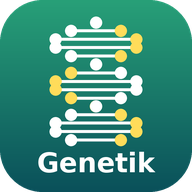
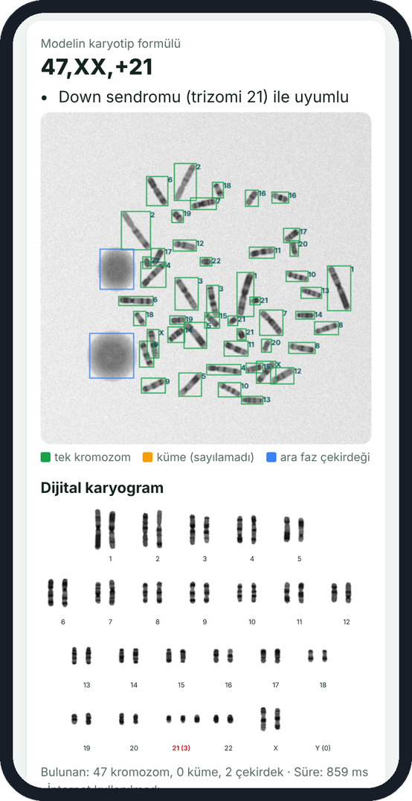
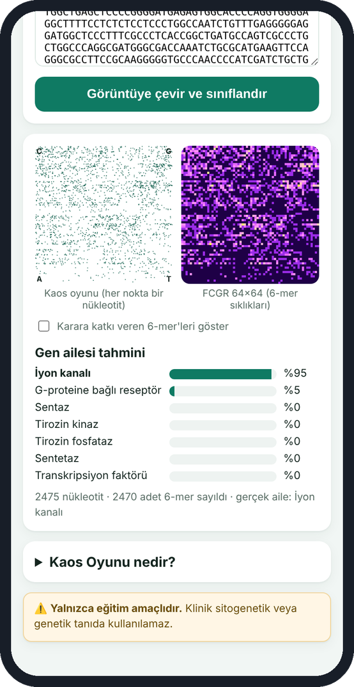
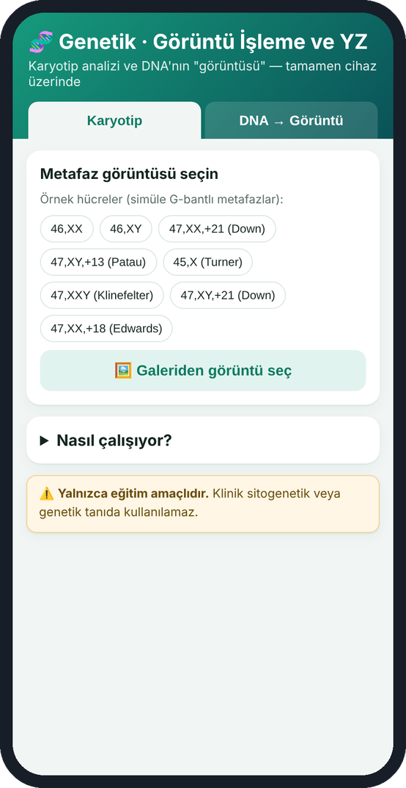
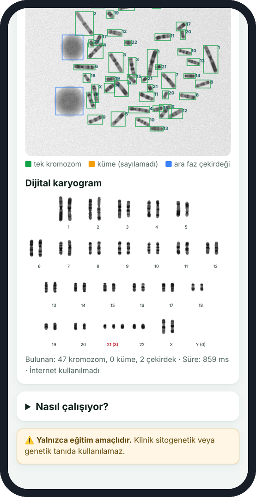
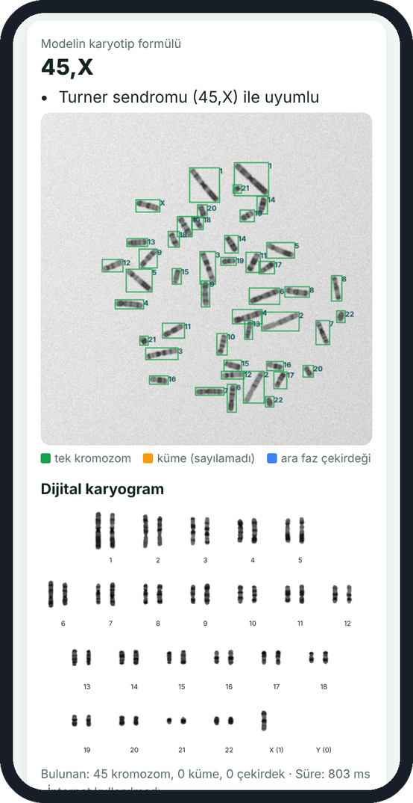
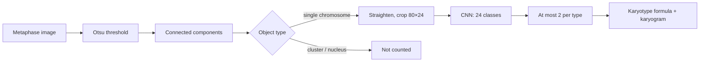
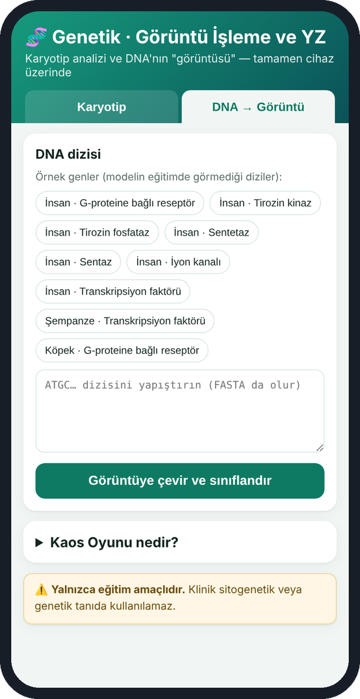
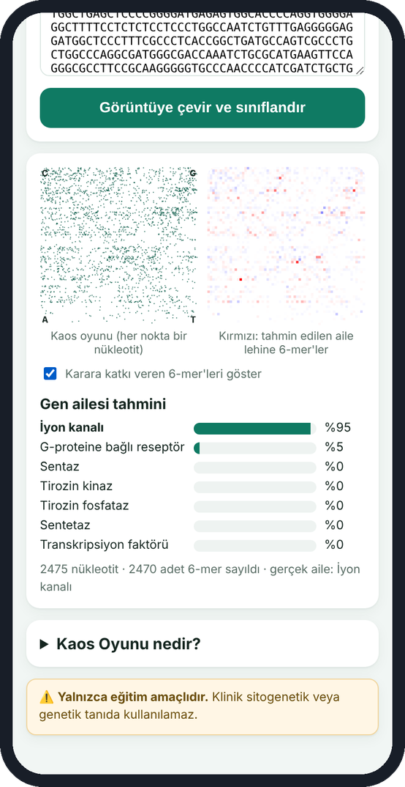

<p align="center"></p>
<h1 align="center">Genetik YZ</h1>
<p align="center"><i>Karyotype analysis and the image of a DNA sequence</i></p>
<p align="center"><a href="README.md">Türkçe</a> · <b>English</b></p>
<p align="center">
  
  
  
</p>

A two-part educational Android app. The **Karyotip** (karyotype) tab counts the chromosomes in a metaphase image, recognizes their types and reports the karyotype formula (e.g. 47,XX,+21). The **DNA → Görüntü** (DNA → image) tab turns a gene sequence into an image with the Chaos Game and predicts its gene family. (*Genetik YZ* = "Genetics AI".)

<p align="center">&nbsp;&nbsp;</p>

> [!IMPORTANT]
> **For educational use only.** Not for clinical diagnosis or treatment decisions.

## At a glance

| Item | Value |
| --- | --- |
| Package name | tr.saglikyz.genetik |
| Version | 1.0 |
| Requires | Android 5.0 or later |
| Size | 2.3 MB |
| Internet permission | None |
| Karyotype model | Otsu thresholding + 24-class CNN; 99% correct type per chromosome |
| DNA model | 6-mer FCGR + logistic regression; 79% on a leakage-free test |
| Data | 160 simulated metaphases (test) · 4,380 human gene sequences |

**Download:** [`Genetik_YZ.apk`](Genetik_YZ.apk)

## Contents

- [Installation](#installation)
- [Karyotype tab](#karyotype-tab)
- [DNA → image tab](#dna--image-tab)
- [Troubleshooting](#troubleshooting)
- [Teaching tips](#teaching-tips)
- [Data and model](#data-and-model)
- [For developers](#for-developers)

## Installation

The app is not on the Play Store; it is installed directly from the APK file. Android 5.0 or later is required.

1. Copy `Genetik_YZ.apk` to the phone (WhatsApp, e-mail, Google Drive or USB cable).
2. On the phone, tap the APK in the **Files** or **Downloads** folder.
3. If an "Install unknown apps" warning appears, tap **Settings**, turn on **Allow from this source** for the app you opened the file with (e.g. Files, Chrome), and go back.
4. Tap **Install**. If Play Protect warns about an "unrecognized developer", choose **More details → Install anyway**.
5. The app icon appears on the home screen or in the app list.

**To open it on a computer:** open `mobil/www/index.html` in Chrome or Edge; no installation or internet is needed. This is the easiest way to project the app during a lecture (for a phone-sized view press F12 → device toolbar).

> [!NOTE]
> The app interface is in Turkish. Button and label names below are given as they appear on screen, followed by an English translation.

## Karyotype tab

1. The app opens on the **Karyotip** tab. Tap one of the eight sample cells: 46,XX · 46,XY · two Down · Edwards · Patau · Turner · Klinefelter. Or load your own image with **Galeriden görüntü seç** ("Select image from gallery").
2. Within about 1 second the result card opens: at the top, the model's karyotype formula and its clinical interpretation.
3. In the image below, every object is boxed and each chromosome is labeled with the number the model assigned.

<p align="center">&nbsp;&nbsp;</p>
<p align="center"><sub>Figure 1. Left: Karyotype tab with sample cells. Right: a 47,XX,+21 result with labeled chromosomes.</sub></p>

| Box color | Meaning |
| --- | --- |
| Green | Single chromosome; included in counting and classification |
| Orange | Cluster of touching or overlapping chromosomes; could not be counted, and the result shows a warning |
| Blue | Interphase nucleus; excluded from the count |

4. Scroll down: the **Dijital karyogram** (digital karyogram) arranges the chromosomes from 1 to 22 plus X and Y. A type whose count differs from the expected number is shown in red with its count in brackets, e.g. **21 (3)**.
5. The bottom line shows how many objects were found and the analysis time.

<p align="center">&nbsp;&nbsp;</p>
<p align="center"><sub>Figure 2. Left: digital karyogram with three copies of chromosome 21. Right: 45,X in the Turner sample.</sub></p>



> [!NOTE]
> **Limits of the karyotype tab:** the model was trained only on computer-**simulated** G-banded metaphases; results on real microscope photos are not reliable. It detects numerical anomalies only and cannot see structural ones such as translocations or deletions. On cells with well-separated chromosomes it gets the full formula right about 79% of the time.

## DNA → image tab

1. Tap the **DNA → Görüntü** tab at the top.
2. Pick one of nine sample genes (seven human genes, one from each gene family, plus one chimpanzee and one dog gene) or paste your own sequence into the box. FASTA format (a header line starting with `>`) is accepted; at least 50 nucleotides are required.
3. Tap **Görüntüye çevir ve sınıflandır** ("Convert to image and classify"); it runs automatically when a sample is chosen.

<p align="center">&nbsp;&nbsp;</p>
<p align="center"><sub>Figure 3. Left: DNA tab with sample genes. Right: Chaos Game image of an ion-channel gene and the prediction.</sub></p>

| On screen | Meaning |
| --- | --- |
| Kaos oyunu (left square) | Each nucleotide is a point. Corners: A (bottom left), C (top left), G (top right), T (bottom right) |
| FCGR 64×64 (right square) | Each pixel is the frequency of one 6-letter subsequence (6-mer); bright = frequent |
| Gen ailesi tahmini (gene family prediction) | Probabilities for the seven gene families, from most to least likely |
| Bottom line | Sequence length and number of 6-mers counted; for a sample gene, its true family |

4. Tick **Karara katkı veren 6-mer'leri göster** ("Show 6-mers that drive the decision"): the right square then shows the subsequences voting for (red) and against (blue) the predicted family.

<p align="center"></p>
<p align="center"><sub>Figure 4. With the decision-driving 6-mers shown.</sub></p>

**What is the Chaos Game?** Place A, C, G and T at the corners of a square, start in the middle, and for each letter move halfway between the current point and that letter's corner (Jeffrey, 1990). The resulting pattern shows the frequency of every k-mer in the sequence in a single picture.

> [!NOTE]
> **Limits of the DNA tab:** the model knows only seven gene families (G protein-coupled receptor, tyrosine kinase, tyrosine phosphatase, synthetase, synthase, ion channel, transcription factor); given any other sequence it will still pick one of them. Measured with similar sequences kept apart, accuracy on human genes is about 79%.

## Troubleshooting

| Problem | Fix |
| --- | --- |
| "App not installed" | An older version with the same package name is installed: uninstall it first, then install again. |
| "This type of file can harm your device" | This is the browser's download warning; choose **Download anyway**. The app requests no internet permission. |
| Play Protect warning during installation | **More details → Install anyway**. |
| The result is slow | On older phones a karyotype analysis can take a few seconds; do not tap the button again. |
| Orange boxes and a "sayılamadı" (could not be counted) warning | Chromosomes are touching; this cell is not suitable for counting, choose a better-spread cell. |
| "En az 50 nükleotit" (at least 50 nucleotides) warning | Only A, C, G and T are counted; protein (amino acid) sequences are not accepted. |

## Teaching tips

Open 46,XX and then 47,XX,+21 and point out the red **21 (3)** label in the karyogram. Then, in the DNA tab, compare the Chaos Game patterns of a human and a dog gene from the same family.

## Data and model

The metaphase images were **simulated** for this project with `karyotip_sim.py` (real relative lengths, centromere positions and type-specific banding patterns); they are not patient data. DNA sequences: N. Singh, *DNA sequence dataset* (Kaggle) — 4,380 human, 1,682 chimpanzee and 820 dog genes. Details: notebooks 3.1–3.3 (in Turkish).

## For developers

### Folder structure

```
03_Genetik/
├── 3_1_Metafazdan_Kromozom_Sayimina.ipynb
├── 3_2_YZ_ile_Kromozom_Tanima_ve_Karyogram.ipynb  ← kromozom_model.js
├── 3_3_DNA_Dizisinden_Goruntuye_CGR.ipynb         ← dna_model.js
├── karyotip_sim.py      ← synthetic metaphase generator
├── kromozom_isleme.py   ← counting and cropping (identical to karyotip.js)
├── dna_goruntu.py       ← Chaos Game / FCGR (identical to dna.js)
├── yz_aktar.py
├── veri/  metafaz/ (160 images + etiketler.json labels) · dna/
├── model/
├── mobil/
│   ├── www/  index.html · app.js · karyotip.js · dna.js · yzmotor.js · *_model.js · ornek_*.js
│   ├── ikon.png
│   └── apk_derleme/
└── Genetik_YZ.apk
```

### Rebuilding the APK

The app is a very small Android WebView shell that displays the HTML + JavaScript in `mobil/www/`; Gradle and Android Studio are not needed. On Ubuntu/Debian:

```bash
sudo apt install android-sdk android-sdk-platform-23 openjdk-17-jdk
./mobil/apk_derleme/build_apk.sh mobil/www tr.saglikyz.genetik "Genetik YZ" "#0a5257" mobil/ikon.png Genetik_YZ.apk
```

`mobil/apk_derleme/saglikyz.keystore` is a signing key created for teaching only (its password is written in the script). If you distribute the app, generate your own key: `keytool -genkeypair -keystore my.keystore -alias mine -keyalg RSA -keysize 2048 -validity 10000`.

### Retraining the model

The model files (`mobil/www/*model*.js`) are produced in the last section of the notebooks. Re-run the notebook from the top and repeat the build command above. The notebook also checks automatically that the JavaScript engine on the phone gives the same results as the Python model.

## License and attribution

The code and guide are shared for educational purposes. The datasets used are subject to their own licenses; cite the original source of each dataset in publications. Results from the app are not medical advice.
