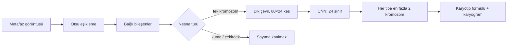

<p align="center"></p>
<h1 align="center">Genetik YZ</h1>
<p align="center"><i>Karyotip analizi ve DNA dizisinin görüntüsü</i></p>
<p align="center"><b>Türkçe</b> · <a href="README.en.md">English</a></p>
<p align="center">
  
  
  
</p>

İki bölümlü eğitim uygulaması: Karyotip sekmesi bir metafaz görüntüsünden kromozomları sayar, tiplerini tanır ve karyotip formülünü (ör. 47,XX,+21) verir; DNA → Görüntü sekmesi bir gen dizisini Kaos Oyunu ile görüntüye çevirip gen ailesini tahmin eder.

<p align="center">&nbsp;&nbsp;</p>

> [!IMPORTANT]
> **Yalnızca eğitim amaçlıdır.** Klinik tanı veya tedavi kararında kullanılamaz.

## Özet

| Özellik | Değer |
| --- | --- |
| Paket adı | tr.saglikyz.genetik |
| Sürüm | 1.0 |
| Gereksinim | Android 5.0 ve üzeri |
| Boyut | 2,3 MB |
| İnternet izni | Yok |
| Karyotip modeli | Otsu eşikleme + 24 sınıflı CNN; kromozom başına %99 doğru tip |
| DNA modeli | 6-mer FCGR + lojistik regresyon; sızıntısız test %79 |
| Veri | 160 simüle metafaz (test) · 4.380 insan gen dizisi |

**İndir:** [`Genetik_YZ.apk`](Genetik_YZ.apk)

## İçindekiler

- [Kurulum](#kurulum)
- [Karyotip sekmesi](#karyotip-sekmesi)
- [DNA → Görüntü sekmesi](#dna--görüntü-sekmesi)
- [Sorun giderme](#sorun-giderme)
- [Sunumda kullanım](#sunumda-kullanım)
- [Veri ve model](#veri-ve-model)
- [Geliştiriciler için](#geliştiriciler-için)

## Kurulum

Uygulama Play Store'da değildir; APK dosyasıyla doğrudan kurulur. Android 5.0 ve üzeri gerekir.

1. `Genetik_YZ.apk` dosyasını telefona aktarın (WhatsApp, e-posta, Google Drive veya USB kablo).
2. Telefonda **Dosyalar** veya **İndirilenler** klasöründen APK'ya dokunun.
3. "Bilinmeyen uygulamaları yükle" uyarısı çıkarsa **Ayarlar**'a dokunun, dosyayı açtığınız uygulama (ör. Dosyalar, Chrome) için **Bu kaynaktan izin ver**'i açın ve geri dönün.
4. **Yükle**'ye dokunun. Play Protect "tanınmayan geliştirici" uyarısı verirse **Ayrıntılar → Yine de yükle**'yi seçin.
5. Uygulama simgesi ana ekranda veya uygulama listesinde görünür.

**Bilgisayarda açmak için:** `mobil/www/index.html` dosyasını Chrome veya Edge ile açın; kurulum ve internet gerekmez. Sunumda projeksiyona yansıtmanın en kolay yolu budur (telefon görünümü için F12 → cihaz simgesi).

## Karyotip sekmesi

1. Uygulama Karyotip sekmesinde açılır. Sekiz örnek hücreden birine dokunun: 46,XX · 46,XY · iki Down · Edwards · Patau · Turner · Klinefelter. Ya da **Galeriden görüntü seç** ile kendi görüntünüzü yükleyin.
2. Yaklaşık 1 saniye içinde sonuç kartı açılır: en üstte modelin karyotip formülü ve klinik yorumu.
3. Altındaki görüntüde her nesne bir kutuyla işaretlenir ve her kromozomun yanına modelin verdiği numara yazılır.

<p align="center">&nbsp;&nbsp;</p>
<p align="center"><sub>Şekil 1. Sol: Karyotip sekmesi ve örnek hücreler. Sağ: 47,XX,+21 sonucu ve işaretli kromozomlar.</sub></p>

| Kutu rengi | Anlamı |
| --- | --- |
| Yeşil | Tek kromozom; sayıma ve sınıflandırmaya katıldı |
| Turuncu | Küme: değen veya üst üste binen kromozomlar; sayılamadı, sonuçta uyarı çıkar |
| Mavi | Ara faz çekirdeği; sayıma katılmaz |

4. Aşağı kaydırın: **Dijital karyogram**, kromozomları 1'den 22'ye ve X, Y'ye dizer. Sayısı beklenenden farklı olan tip kırmızı yazılır ve parantez içinde adedi gösterilir, örneğin **21 (3)**.
5. En altta bulunan nesne sayıları ve analiz süresi yer alır.

<p align="center">&nbsp;&nbsp;</p>
<p align="center"><sub>Şekil 2. Sol: dijital karyogram, 21 numaralı kromozomdan 3 adet. Sağ: Turner örneğinde 45,X.</sub></p>



> [!NOTE]
> **Karyotip sekmesinin sınırları:** Model yalnızca bilgisayarda **simüle edilmiş** G-bantlı metafazlarla eğitildi; gerçek mikroskop fotoğraflarında sonuç güvenilir değildir. Yalnızca sayısal anomalileri yakalar; translokasyon ve delesyon gibi yapısal anomalileri göremez. Ayrık kromozomlu hücrelerde formülü tam doğru bulma oranı yaklaşık %79'dur.

## DNA → Görüntü sekmesi

1. Üstteki **DNA → Görüntü** sekmesine dokunun.
2. Dokuz örnek genden birini seçin (yedi insan geni, her gen ailesinden bir tane; bir şempanze ve bir köpek geni) ya da kutuya kendi dizinizi yapıştırın. FASTA biçimi (`>` ile başlayan başlık satırı) kabul edilir; en az 50 nükleotit gerekir.
3. **Görüntüye çevir ve sınıflandır**'a dokunun (örnek seçildiğinde kendiliğinden çalışır).

<p align="center">&nbsp;&nbsp;</p>
<p align="center"><sub>Şekil 3. Sol: DNA sekmesi ve örnek genler. Sağ: iyon kanalı geninin Kaos Oyunu görüntüsü ve tahmin.</sub></p>

| Ekrandaki öğe | Anlamı |
| --- | --- |
| Kaos oyunu (sol kare) | Her nükleotit bir nokta. Köşeler A (sol alt), C (sol üst), G (sağ üst), T (sağ alt) |
| FCGR 64×64 (sağ kare) | Her piksel bir 6 harflik dizi parçasının (6-mer) sıklığı; parlak = sık |
| Gen ailesi tahmini | Yedi gen ailesinin olasılıkları, en olasıdan en aza |
| Alt satır | Dizi uzunluğu, sayılan 6-mer adedi; örnek gende gerçek aile |

4. **Karara katkı veren 6-mer'leri göster** kutusunu işaretleyin: sağ kare, tahmin edilen aile lehine (kırmızı) ve aleyhine (mavi) oy veren dizi parçalarını gösterir.

<p align="center"></p>
<p align="center"><sub>Şekil 4. Karara katkı veren 6-mer'ler açıkken.</sub></p>

**Kaos Oyunu nedir?** Karenin köşelerine A, C, G, T konur; ortadan başlanır ve her harfte, bulunulan nokta ile o harfin köşesinin tam ortasına gidilir (Jeffrey, 1990). Ortaya çıkan desen dizideki tüm k-mer'lerin sıklığını tek bir resimde gösterir.

> [!NOTE]
> **DNA sekmesinin sınırları:** Model yalnızca yedi gen ailesini tanır (G-proteine bağlı reseptör, tirozin kinaz, tirozin fosfataz, sentetaz, sentaz, iyon kanalı, transkripsiyon faktörü); başka bir dizi verilse de bu yedisinden birini seçer. Benzer diziler ayrılarak ölçülen doğruluk insan genlerinde yaklaşık %79'dur.

## Sorun giderme

| Sorun | Çözüm |
| --- | --- |
| "Uygulama yüklenmedi" | Aynı paket adıyla eski bir sürüm var: önce eskisini kaldırın, sonra tekrar yükleyin. |
| "Bu tür dosya cihazınıza zarar verebilir" | Tarayıcının indirme uyarısıdır; **Yine de indir** deyin. Uygulama internet izni istemez. |
| Kurulumda Play Protect uyarısı | **Ayrıntılar → Yine de yükle**. |
| Sonuç geç geliyor | Eski telefonlarda karyotip analizi birkaç saniye sürebilir; düğmeye tekrar basmayın. |
| Turuncu kutular ve "sayılamadı" uyarısı | Kromozomlar birbirine değiyor; bu hücre sayım için uygun değil, daha iyi yayılmış bir hücre seçin. |
| "En az 50 nükleotit" uyarısı | Dizide yalnızca A, C, G, T sayılır; protein (amino asit) dizisi kabul edilmez. |

## Sunumda kullanım

46,XX ile 47,XX,+21'i art arda açıp karyogramdaki kırmızı **21 (3)** etiketini gösterin. Sonra DNA sekmesinde aynı aileden insan ve köpek geninin Kaos Oyunu desenlerini karşılaştırın.

## Veri ve model

Metafaz görüntüleri bu proje için `karyotip_sim.py` ile **simüle edildi** (gerçek göreli uzunluklar, sentromer konumları, tipe özgü bant desenleri); gerçek hasta verisi değildir. DNA dizileri: N. Singh, *DNA sequence dataset* (Kaggle) — 4.380 insan, 1.682 şempanze, 820 köpek geni. Ayrıntılar: not defterleri 3.1–3.3.

## Geliştiriciler için

### Klasör yapısı

```
03_Genetik/
├── 3_1_Metafazdan_Kromozom_Sayimina.ipynb
├── 3_2_YZ_ile_Kromozom_Tanima_ve_Karyogram.ipynb  ← kromozom_model.js
├── 3_3_DNA_Dizisinden_Goruntuye_CGR.ipynb         ← dna_model.js
├── karyotip_sim.py      ← sentetik metafaz üreteci
├── kromozom_isleme.py   ← sayım ve kesme (karyotip.js ile birebir)
├── dna_goruntu.py       ← Kaos Oyunu / FCGR (dna.js ile birebir)
├── yz_aktar.py
├── veri/  metafaz/ (160 görüntü + etiketler.json) · dna/
├── model/
├── mobil/
│   ├── www/  index.html · app.js · karyotip.js · dna.js · yzmotor.js · *_model.js · ornek_*.js
│   ├── ikon.png
│   └── apk_derleme/
└── Genetik_YZ.apk
```

### APK'yı yeniden derlemek

Uygulama, `mobil/www/` içindeki HTML + JavaScript'i gösteren çok küçük bir Android WebView kabuğudur; Gradle veya Android Studio gerekmez. Ubuntu/Debian'da:

```bash
sudo apt install android-sdk android-sdk-platform-23 openjdk-17-jdk
./mobil/apk_derleme/build_apk.sh mobil/www tr.saglikyz.genetik "Genetik YZ" "#0a5257" mobil/ikon.png Genetik_YZ.apk
```

`mobil/apk_derleme/saglikyz.keystore` yalnızca eğitim için oluşturulmuş bir imza anahtarıdır (parolası betikte yazılıdır). Uygulamayı dağıtacaksanız kendi anahtarınızı üretin: `keytool -genkeypair -keystore benim.keystore -alias benim -keyalg RSA -keysize 2048 -validity 10000`.

### Modeli yeniden eğitmek

Model dosyaları (`mobil/www/*model*.js`) not defterlerinin son bölümünde üretilir. Not defterini baştan çalıştırıp yukarıdaki derleme komutunu tekrarlamak yeterlidir. Not defteri, telefondaki JavaScript motorunun Python modeliyle aynı sonucu verdiğini de otomatik olarak doğrular.

## Lisans ve atıf

Kod ve kılavuz eğitim amacıyla paylaşılmıştır. Kullanılan veri setleri kendi lisanslarına tabidir; yayınlarda veri setinin özgün kaynağına atıf yapın. Uygulamanın verdiği sonuçlar tıbbi tavsiye değildir.
